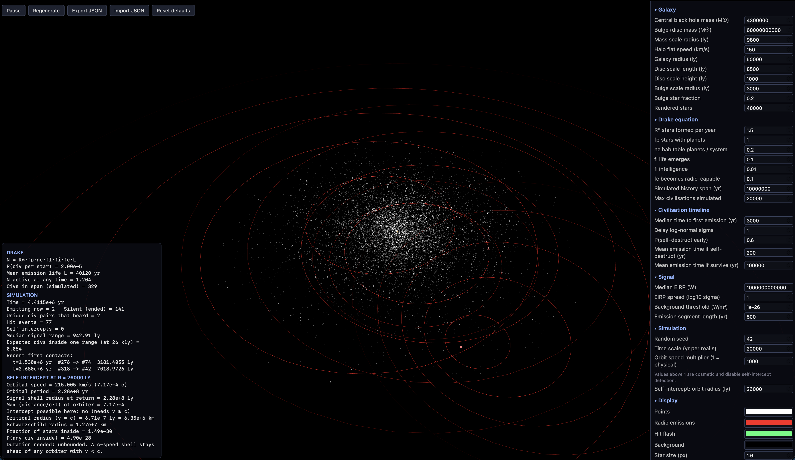

# Darkness in the Forest

A little galaxy simulation for poking at the "dark forest" idea: civilisations start shouting into space with radio, then often wipe themselves out not long after, so the sky stays quiet. Stars orbit a supermassive black hole, a handful of them light up as radio emitters based on the Drake equation, and signals spread out at light speed. If a signal is still strong enough when it reaches another civilisation that's actually transmitting at the time, you get a hit. It's built with plain JavaScript, HTML and CSS, plus three.js for the drawing.



## Running it

You need to serve the folder over HTTP (browsers won't load ES modules straight from a file), so from the project folder run:

```
python3 -m http.server 9000
```

Then open <http://localhost:9000>. Three.js comes from a CDN, so you'll need to be online.

## Features

- Stars orbit the galactic centre using a rotation curve built from the black hole, bulge/disc mass and a dark matter halo, so they move faster toward the middle
- Number of civilisations comes from the Drake equation, with every factor editable
- Each civilisation gets a random delay before its first radio emission and a lifetime, with a chance of early self-destruction versus long-term survival
- Radio signals travel at the speed of light and fall off with the inverse square law
- A signal only counts as a hit if it's above the galactic background threshold and the receiver is transmitting when it arrives
- Hits flash the receiving point and draw a line back to the sender
- Self-intercept panel: how close you'd have to orbit to catch your own first signals, and how likely that is (spoiler: you can't, light is faster than your orbit)
- All the constants are tweakable in the side panel
- Export and import your settings as JSON
- Configurable colours (white points, red emissions by default)
- Adjustable time scale, plus a cosmetic orbit speed multiplier and ring size so you can actually see what's going on

## Files

- `index.html`, `css/style.css`: page and styling
- `js/config.js`: default constants and UI schema
- `js/physics.js`: orbits, Drake equation, signal range, self-intercept maths
- `js/sim.js`: civilisation generation and hit detection
- `js/render.js`: three.js scene
- `js/ui.js`, `js/main.js`: settings panel, import/export, main loop

## Notes

Real galactic distances and timescales are huge, so a few settings (orbit speed multiplier, ring radius multiplier) are just for show. The hit detection always uses the real numbers. Hits are rare with the default settings, which is kind of the point, but you can crank up the Drake factors or transmit power if you want to see some.
